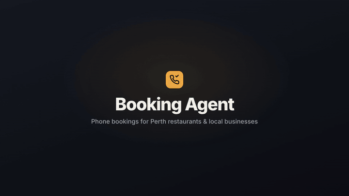

# Booking Agent: animated promo demo v3

A 34-second, self-contained web animation (one HTML file, no build, no
network needed) that shows the Booking Agent story end to end:

| Time | Scene | What's on screen |
|---|---|---|
| 0–3 s | Title | Booking Agent, for Perth restaurants & local businesses |
| 3–6 s | 01 · The call | Owner's phone rings, he answers like always |
| 6–17 s | 02 · Booking Agent listens | In-call screen with a REC badge; side panel shows the recording notice (EN + 中文), a live waveform and the transcript, with the key facts highlighted as they're spoken |
| 17–21 s | 03 · Key facts only | Call ends; a "Booking captured" card lists only name, party size, date, time, phone, notes |
| 21–25 s | 04 · On your WhatsApp | WhatsApp notification, then the tidy summary message |
| 25–30 s | 05 · In your booking calendar | The booking drops into the 7:00 PM slot of Saturday's calendar, allergy note attached |
| 30–34 s | End card | "You take the call. We take the notes." |

The sample booking (Sarah Chen, 6 guests, Sat 21 Nov, 7:00 PM, 0423 456 789,
peanut allergy + window table) and the restaurant name "Lotus Garden" are
made up for the demo.



## Play it

Open `demo-v3/index.html` in Chrome, Edge, Safari or Firefox (double-click
it, or drag it into a browser window). It plays automatically and scales
to fit any window at 16:9.

| Key | Action |
|---|---|
| Space | Play / pause |
| R | Restart from 0 |
| ← / → | Jump back / forward 1 s |
| H | Hide / show the control bar |

URL options (add after `index.html`):

- `?record` hides the control bar and mouse cursor and holds the first
  frame for 1 second, so a screen recorder can start cleanly.
- `?loop` loops forever (good for a trade-show screen).
- `?t=21` starts at 21 seconds; `?paused` starts paused.
- Combine them: `index.html?record&loop`.

## Record it

### Option A: screen recorder (easiest)

1. Open `index.html?record` in a browser and press F11 (Windows) or
   Ctrl+Cmd+F (Mac) to go full screen.
2. Start your recorder:
   - **Mac:** Cmd+Shift+5 → "Record Entire Screen", or QuickTime → File → New Screen Recording.
   - **Windows:** Win+Alt+R (Xbox Game Bar), or OBS Studio.
3. Press **R** in the page to restart from the beginning, then stop the
   recording after the end card (about 35 s).
4. Trim the start and end in QuickTime / Photos / CapCut.

Use a 1920×1080 or larger screen for the sharpest result.

### Option B: frame-perfect MP4 export (no dropped frames)

`capture.mjs` steps through the animation frame by frame in a headless
browser and encodes a clean 1920×1080 MP4. Needs Node 18+ and ffmpeg.

```bash
cd demo-v3
npm i playwright && npx playwright install chromium   # once
node capture.mjs                    # -> out/booking-agent-demo-v3.mp4 (30 fps)
node capture.mjs --gif              # also writes out/preview.gif
node capture.mjs --fps 60 --width 3840   # 4K, 60 fps
```

`out/` is git-ignored.

## Editing the content

Everything lives in `index.html`:

- **Words on the left:** the `#cap1` … `#cap5` blocks.
- **Phone call transcript:** the `LINES` array in the script. Wrap a
  phrase in `{curly braces}` to highlight it as a key fact.
- **Extracted facts:** the `FACTS` array.
- **WhatsApp message:** the `#waMsg` block.
- **Calendar:** the `ev(...)` calls (start hour, length in hours, lane).
- **Timing:** the `T` object (seconds) and `DURATION`.

The animation is a pure function of time (`render(t)`), so scrubbing,
restarting and frame-by-frame export always give the same picture.
